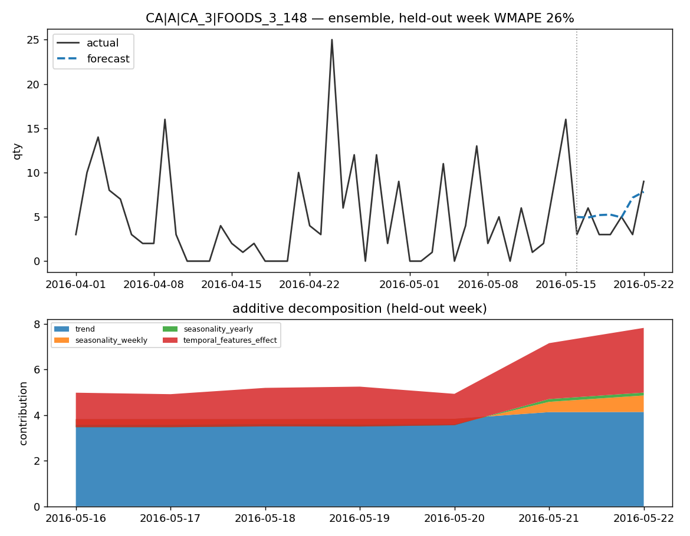
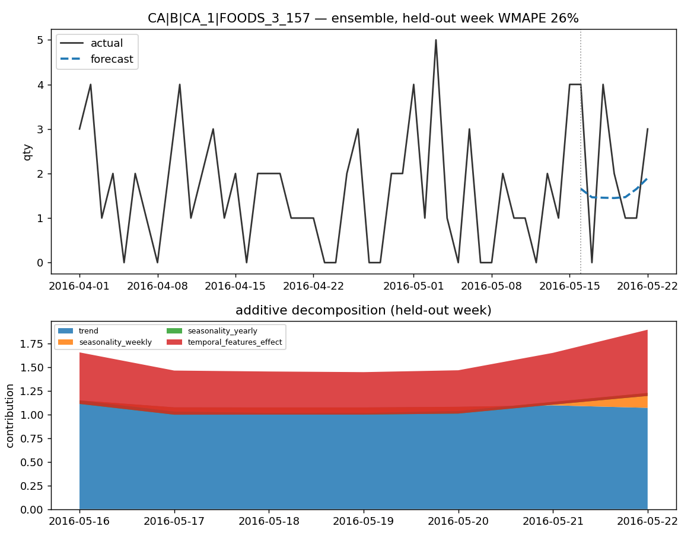
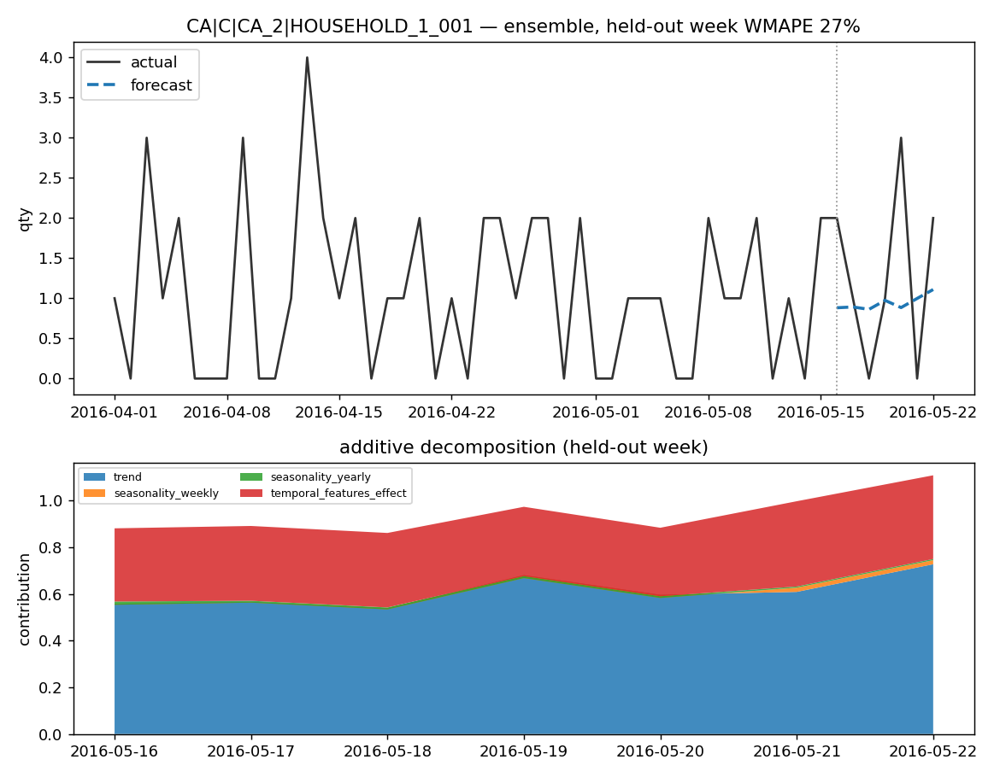

# retail-demand-forecast

A production-shaped **many-models forecasting (MMF)** engine for retail demand: one model per `market × store × sku`, trained and scored independently across thousands of series, with every forecast decomposing additively into trend, seasonality, and named holiday/promo effects.

Built as a personal project to explore the MMF pattern end-to-end on Databricks — feature store, per-series champion/challenger selection, conditional hyperparameter tuning, and a WMAPE gate enforced at three grains — without depending on Databricks' own (unsupported) MMF accelerator package. It targets **Databricks Free Edition** and runs, in miniature, entirely on a laptop with no Spark cluster.

Demo data is Kaggle's **[M5 Forecasting Accuracy](https://www.kaggle.com/competitions/m5-forecasting-accuracy)** dataset — real Walmart daily unit sales, ~30,490 store×item series across CA/TX/WI (state → `market_id`), with a real holiday calendar and SNAP-benefit-day signal. Not included in this repo (Kaggle competition terms don't permit redistribution, and M5 requires your own Kaggle account) — see [Quickstart](#quickstart) to pull your own copy.

[](.github/workflows/ci.yml)

---

## Why this exists

Most public forecasting demos fit one model to one series. Real retail forecasting is the opposite problem: **thousands of series**, each with its own trend, seasonality, and promo calendar, that all need a forecast every day — cheaply. The interesting engineering isn't the model, it's the system around it:

- **Per-series champion/challenger — and measuring whether it actually helps.** Every series can independently compete candidate models (LightGBM, AutoARIMA, statsforecast, Croston, ETS+events, an equal-weight ensemble) through a cost-ordered cascade. Testing that on unseen weeks showed picking the backtest winner per series *hurts* on noisy store-level data, so the shipped default is the ensemble for every series — the selection machinery stays, one config change away (see [Accuracy](#accuracy)).
- **Explainability as a hard constraint.** A model can't become champion unless its forecast decomposes additively into `trend + seasonality_weekly + seasonality_yearly + Σholiday_lift + Σpromo_lift + temporal_features_effect (+ bounded model_uplift)` and reconstructs `yhat` within tolerance. Black-box learners (LightGBM via grouped SHAP, the Stage-2 uplift residual) only ever contribute named terms; the ensemble averages its members' decompositions component by component, so it reconstructs exactly too.
- **Gated against a baseline, at three grains.** Accuracy is gated at the category-cohort, `market×sku` and `market×store×sku` level by *skill*: WMAPE must beat a trailing-28-day-mean forecast by a configured margin. Fixed absolute targets aren't reachable at store×sku grain on sparse retail data (sampling noise alone exceeds them), so "does the model add value over the naive forecast?" is the question the gate asks.
- **Conditional, not routine, tuning.** Hyperparameter search (Optuna) only runs for series that miss the gate, and only in the weekly training job — never in the daily inference path. (It applies to single-model champions; the default ensemble's members run on fixed, regularised defaults.)

See [`docs/instructions.md`](docs/instructions.md) for the full build spec and [`docs/feature_engineering_spec.md`](docs/feature_engineering_spec.md) for the feature pipeline.

---

## Architecture

Three independent Databricks jobs, each parameterized by `market_id`, `env`, and `snapshot_date` (point-in-time — any historical date can be replayed):

```
 control.forecast_config (Delta, app-managed)
        │  (read filtered by market)
        ▼
┌─ JOB 1: DATA ───────────────────────────────────────────────┐
│ source.sales / sku_store / sku / store / events / calendar  │
│  → gold.sku_store_features (point-in-time as of snapshot)   │
└───────────────────────────────────────────────────────────────┘
        ▼
┌─ JOB 2: TRAINING ───────────────────────────────────────────┐
│ per-series (applyInPandas by series_key):                    │
│   fit candidates → backtest 7-day WMAPE → gate 3 grains       │
│   → conditional HPT → decomposition check                     │
│ → gold.champion_index, gold.backtest_metrics                  │
└───────────────────────────────────────────────────────────────┘
        ▼
┌─ JOB 3: INFERENCE ──────────────────────────────────────────┐
│ 140-day future spine → predict + decompose → evaluate →       │
│ conditional HPT retune → re-score → temp_closure → outbound   │
│ → forecast.output, forecast.decomposition                     │
└───────────────────────────────────────────────────────────────┘
```

Each job is a `databricks.yml`-deployed notebook (`notebooks/01_build_features.py`, `02_train.py`, `03_score.py` → `09_outbound.py`), sequenced as separate, individually re-runnable cells calling into tested `.py` modules — never one opaque `main()`. Compute is Databricks Free Edition **serverless** (no clusters to manage).

---

## Accuracy

All numbers are **out-of-sample** on real Kaggle M5 data (CA, 150 randomly sampled store×sku series, ~2 years of history each): models are fit and champions chosen on history that stops before the week being scored. Metric: 7-day WMAPE on weekly totals, pooled across series (`Σ|actual − forecast| / Σ actual`). Regenerate with `python demo/run_local_demo.py` (raw numbers: [`docs/assets/metrics.json`](docs/assets/metrics.json)).

**Held-out week, shipped configuration (ensemble champion for every series):**

| Category | Median units/week per series | Ensemble WMAPE | 28-day-mean baseline | Skill vs baseline | Noise floor* |
|---|---|---|---|---|---|
| A (fast movers) | 12 | 30.0% | 29.4% | −2.1% | 17.9% |
| B | 6 | 42.9% | 43.6% | +1.6% | 30.3% |
| C | 3 | 49.0% | 51.8% | +5.5% | 37.7% |
| SEASONAL | 1 | 47.2% | 59.9% | +21.1% | 47.8% |
| **Overall** | 5 | **35.7%** | **36.6%** | **+2.5%** | 23.7% |

\* *Noise floor* = the WMAPE a perfect forecast of each series' expected weekly demand would still score if weekly sales are Poisson around it. No model can get below it; it is why fixed targets like "85% accuracy at store×sku" are unreachable here — the median category-A series sells 12 units a week.

**Which champion rule to ship — measured, not assumed.** [`demo/compare_selection_rules.py`](demo/compare_selection_rules.py) forecasts 8 consecutive weeks for a different 150-series sample, lets each rule choose using only the 3 preceding weeks, and scores it on the week it never saw (750 series-weeks; 90% interval from a series bootstrap; raw numbers: [`docs/assets/selection_rules.json`](docs/assets/selection_rules.json)):

| Champion rule | WMAPE | Skill vs baseline | 90% interval |
|---|---|---|---|
| **Always the ensemble (shipped)** | **37.8%** | **+1.4%** | −3.2% … +6.2% |
| 28-day-mean baseline | 38.3% | — | — |
| Ensemble unless a single model beats it by 30% in backtest | 39.4% | −2.8% | −8.2% … +3.0% |
| Always LightGBM | 39.6% | −3.4% | −9.0% … +2.9% |
| Ensemble unless a single model beats it by 10% in backtest | 40.0% | −4.2% | −8.8% … +0.5% |
| Best candidate per series (classic MMF champion/challenger) | 41.1% | **−7.1%** | −13.7% … 0.0% |

**What this says, plainly:**
- At daily store×sku grain on M5, a 28-day moving average is a strong forecast, and most of the remaining error is irreducible noise. The ensemble edges it out on average but the margin is within sampling error — this project does not claim a big accuracy win over a naive forecast at this grain.
- **Per-series champion selection overfits.** Choosing the backtest winner from a few noisy weeks picks whichever model got lucky; out of sample it is the *worst* rule tested, 7% behind the baseline with the 90% interval sitting at or below zero. That is why the shipped default is one robust ensemble per series, and why the backtest gate's own skill numbers (+7–19% in `metrics.json`) are not used as the headline: they're scored on the weeks the models were fit around.
- Concrete accuracy changes made on the way: LightGBM regularised for single-series data (pooled backtest WMAPE 43.4% → 39.9% and 41.2% → 37.6% on two samples), the equal-weight ensemble, and the demo now evaluating the production candidate set instead of a different one.

Bigger accuracy gains at this grain would need information the per-series models don't have — cross-series learning (a global LightGBM across all series, as M5's winning entries used; [`training/global_lgbm.py`](training/global_lgbm.py) is a start) and price features — rather than more per-series model choice.

---

## Example forecasts

Each chart: actual vs. forecast for the held-out week (top) and the additive decomposition of that forecast (bottom) — the components sum to the forecast line. `demo/run_local_demo.py` picks **typical** series automatically — the ones closest to the median held-out WMAPE, one per category, among series selling at least 7 units that week — not the best ones.

**`CA|A|CA_3|FOODS_3_148`** — 32 units that week, held-out WMAPE 26%



**`CA|B|CA_1|FOODS_3_157`** — 15 units that week, held-out WMAPE 26%



**`CA|C|CA_2|HOUSEHOLD_1_001`** — 9 units that week, held-out WMAPE 27%



---

## Speed & scale

| | Measured (this demo, laptop) | Design target (docs/instructions.md) |
|---|---|---|
| Series fit + backtested + gated | 0.28 series/sec, single-threaded pandas (150 series, 3-fold backtest + held-out refit of the 3-model ensemble, in 545s) | thousands/sec, distributed via Spark `applyInPandas` |
| Compute | none — local pandas, no cluster | Databricks Free Edition serverless |
| Registered MLflow models | — (demo doesn't register; production path is) | 1 per `market×category` (not per series — stays far under the ~10k registry ceiling at scale) |
| Daily inference cost target | — | < $100/run |

The demo intentionally runs the same **pandas-only reference implementation** (`training/engine.py::fit_one_series`) that the test suite uses — not the Spark-distributed production path (`training/engine_layered.py::run_engine_layered`). It's slower per-series but requires zero infrastructure, which is the point of a local demo.

---

## Quickstart

### Get the M5 dataset (one-time; needs your own Kaggle account)

M5 is a Kaggle **competition**, not a plain downloadable dataset — you need a free Kaggle account, and you must accept the competition rules on [kaggle.com](https://www.kaggle.com/competitions/m5-forecasting-accuracy/rules) before the API will let you download it.

```bash
pip install kaggle
# place your API token (from kaggle.com/settings) at ~/.kaggle/kaggle.json
kaggle competitions download -c m5-forecasting-accuracy -p data/m5_raw
unzip data/m5_raw/m5-forecasting-accuracy.zip -d data/m5_raw
```

`data/m5_raw/` is gitignored — the files never get committed (large, and Kaggle's terms don't permit redistribution).

### Run the local demo (no Databricks, no Spark)

```bash
pip install -r requirements.txt
python demo/run_local_demo.py
```

Loads M5 (defaults to CA, 300 sampled skus, trailing 2 years — see the constants at the top of `demo/run_local_demo.py`), fits real models, and writes `docs/assets/metrics.json` + the forecast charts referenced above.

### Deploy to Databricks Free Edition

```bash
databricks auth login   # or `databricks configure --host <your-workspace-url>`
databricks bundle deploy
```

Then, in the deployed workspace: run `notebooks/00_create_tables.py` to create the tables; upload the M5 CSVs to a Unity Catalog Volume and run `notebooks/00b_ingest_m5.py` (see its header cell) to load them as source data; seed config via `config/seed_defaults.py`; then run JOB 1 → JOB 2 → JOB 3 in order. See `databricks.yml` for the full job graph.

### Run the tests

```bash
pytest tests/ -v          # 193 tests, pure pandas + mocked spark/dbutils, no Spark needed
ruff check .
```

---

## Repo tour

```
config/       Delta-table config (EAV, app-managed) + loader — no YAML per market
data/         JOB 1: feature pipeline (data/features/) + M5 dataset loader (data/kaggle_m5/)
training/     JOB 2: engine, model wrappers, decomposition contract, champion selection, HPT
inference/    JOB 3: future spine, scoring, data-quality checks
notebooks/    the actual deployed pipeline — one notebook per job, one cell per step
demo/         no-Spark local demo (this README's numbers + charts) + champion-rule experiment
tests/        193 tests, pandas fixtures + mocked spark/dbutils — no Spark required
agents/       phase 2, not built (monitoring/diagnosis agents) — placeholder only
overrides/    phase 2, not built (planner override feedback loop) — placeholder only
```

Full build spec: [`docs/instructions.md`](docs/instructions.md). Feature engineering spec: [`docs/feature_engineering_spec.md`](docs/feature_engineering_spec.md).

**Deliberately not built:** item-proxy/store-proxy backfill and level-adaptation error-ratio correction (removed to keep this project focused on the core modeling engine, not downstream adjustment layers), and the phase-2 agents/override-feedback loop (interfaces are specced in the docs above, but nothing is wired until the modeling core is solid).
