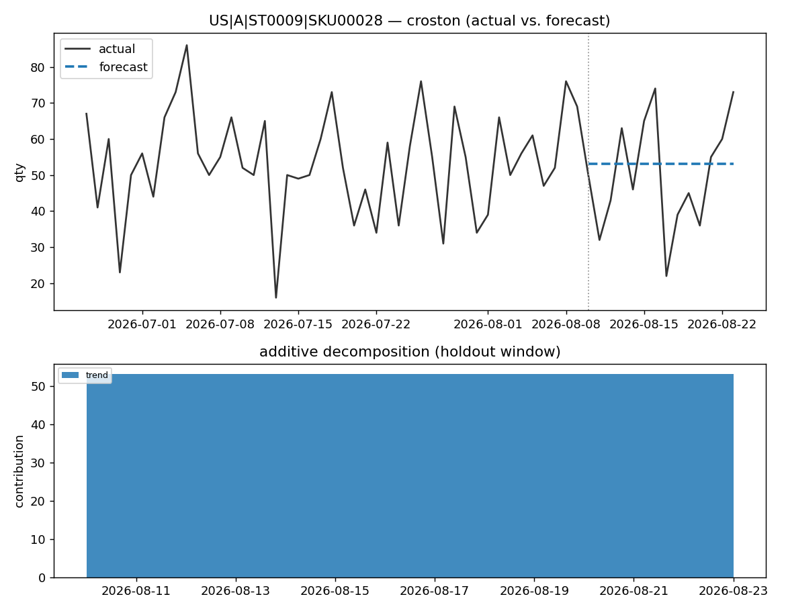
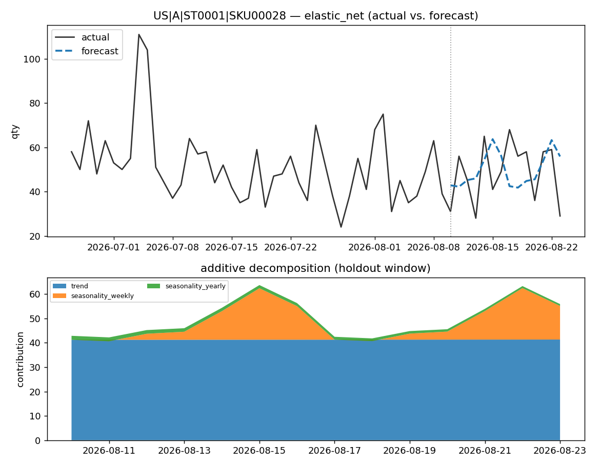
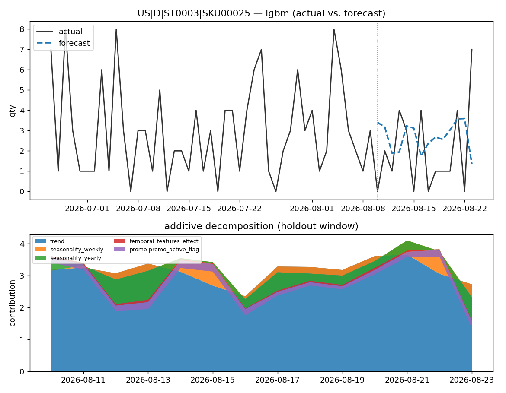

# retail-demand-forecast

A production-shaped **many-models forecasting (MMF)** engine for retail demand: one model per `market × store × sku`, trained and scored independently across thousands of series, with every forecast decomposing additively into trend, seasonality, and named holiday/promo effects.

Built as a personal project to explore the MMF pattern end-to-end on Databricks — feature store, per-series champion/challenger selection, conditional hyperparameter tuning, and a WMAPE gate enforced at three grains — without depending on Databricks' own (unsupported) MMF accelerator package. It targets **Databricks Free Edition** and runs, in miniature, entirely on a laptop with no Spark cluster.

[](.github/workflows/ci.yml)

---

## Why this exists

Most public forecasting demos fit one model to one series. Real retail forecasting is the opposite problem: **thousands of series**, each with its own trend, seasonality, and promo calendar, that all need a forecast every day — cheaply. The interesting engineering isn't the model, it's the system around it:

- **Per-series champion/challenger.** Every series independently competes several candidate models (Prophet, statsforecast, LightGBM, ElasticNet, Croston) and keeps whichever wins — no single "best" algorithm assumed globally.
- **Explainability as a hard constraint.** A model can't become champion unless its forecast decomposes additively into `trend + seasonality_weekly + seasonality_yearly + Σholiday_lift + Σpromo_lift + temporal_features_effect (+ bounded model_uplift)` and reconstructs `yhat` within tolerance. Black-box learners (LightGBM, the Stage-2 uplift residual) only ever contribute a bounded, named term — never the whole forecast unexplained.
- **Gated at three grains.** Accuracy (WMAPE) is checked at the category-cohort, `market×sku`, and `market×store×sku` level — the finest grain is the hardest to pass and the real target.
- **Conditional, not routine, tuning.** Hyperparameter search (Optuna) only runs for series that miss the gate, and only in the weekly training job — never in the daily inference path.

See [`docs/instructions.md`](docs/instructions.md) for the full build spec and [`docs/feature_engineering_spec.md`](docs/feature_engineering_spec.md) for the feature pipeline.

---

## Architecture

Three independent Databricks jobs, each parameterized by `market_id`, `env`, and `snapshot_date` (point-in-time — any historical date can be replayed):

```
 control.forecast_config (Delta, app-managed)
        │  (read filtered by market)
        ▼
┌─ JOB 1: DATA ───────────────────────────────────────────────┐
│ source.sales / sku_store / sku / store / events / calendar  │
│  → gold.sku_store_features (point-in-time as of snapshot)   │
└───────────────────────────────────────────────────────────────┘
        ▼
┌─ JOB 2: TRAINING ───────────────────────────────────────────┐
│ per-series (applyInPandas by series_key):                    │
│   fit candidates → backtest 7-day WMAPE → gate 3 grains       │
│   → conditional HPT → decomposition check                     │
│ → gold.champion_index, gold.backtest_metrics                  │
└───────────────────────────────────────────────────────────────┘
        ▼
┌─ JOB 3: INFERENCE ──────────────────────────────────────────┐
│ 140-day future spine → predict + decompose → evaluate →       │
│ conditional HPT retune → re-score → temp_closure → outbound   │
│ → forecast.output, forecast.decomposition                     │
└───────────────────────────────────────────────────────────────┘
```

Each job is a `databricks.yml`-deployed notebook (`notebooks/01_build_features.py`, `02_train.py`, `03_score.py` → `09_outbound.py`), sequenced as separate, individually re-runnable cells calling into tested `.py` modules — never one opaque `main()`. Compute is Databricks Free Edition **serverless** (no clusters to manage).

---

## Accuracy

Measured on the included synthetic demo dataset (`demo/run_local_demo.py` — 40 sampled series, 12 stores × 40 skus, ~2 years of daily history), gated against per-category WMAPE thresholds:

| Category | WMAPE | Accuracy threshold | Gate |
|---|---|---|---|
| A (fast movers) | 8.0% | 85% | ✅ pass |
| B | 12.9% | 75% | ✅ pass |
| C | 11.0% | 65% | ✅ pass |
| D (long tail) | 34.7% | 60% | ✅ pass |
| SEASONAL | 14.6% | 80% | ✅ pass |
| **Overall (volume-weighted)** | **12.7%** | — | — |

*These are demo numbers on synthetic data, not a real retailer's results — they exist to prove the accuracy-gating machinery actually works end-to-end, not as a performance claim.* Regenerate anytime with `python demo/run_local_demo.py`; results are seeded and reproducible.

---

## Example forecasts

Each chart: actual vs. forecast (top) and the additive decomposition of the 14-day holdout (bottom) — the components literally sum to the forecast line above.

| | |
|---|---|
|  |  |
|  | |

Three different champion models, three different series — picked automatically by `select_champions`, not hand-curated.

---

## Speed & scale

| | Measured (this demo, laptop) | Design target (docs/instructions.md) |
|---|---|---|
| Series fit + backtested + gated | ~2.8 series/sec, single-threaded pandas | thousands/sec, distributed via Spark `applyInPandas` |
| Compute | none — local pandas, no cluster | Databricks Free Edition serverless |
| Registered MLflow models | — | 1 per `market×category` (not per series — stays far under the ~10k registry ceiling at scale) |
| Daily inference cost target | — | < $100/run |

The demo intentionally runs the same **pandas-only reference implementation** (`training/engine.py::fit_one_series`) that the test suite uses — not the Spark-distributed production path (`training/engine_layered.py::run_engine_layered`). It's slower per-series but requires zero infrastructure, which is the point of a local demo.

---

## Quickstart

### Run the local demo (no Databricks, no Spark)

```bash
pip install -r requirements.txt
python demo/run_local_demo.py
```

Generates synthetic data, fits real models, and refreshes `docs/assets/metrics.json` + the forecast charts above.

### Deploy to Databricks Free Edition

```bash
databricks auth login   # or `databricks configure --host <your-workspace-url>`
databricks bundle deploy
```

Then, in the deployed workspace: run `notebooks/00_create_tables.py` to create the tables, `notebooks/00b_generate_synthetic_source.py` to seed synthetic source data (or point `data/synthetic/generator.py` at your own data), seed config via `config/seed_defaults.py`, then run JOB 1 → JOB 2 → JOB 3 in order. See `databricks.yml` for the full job graph.

### Run the tests

```bash
pytest tests/ -v          # 156 tests, pure pandas + mocked spark/dbutils, no Spark needed
ruff check .
```

---

## Repo tour

```
config/       Delta-table config (EAV, app-managed) + loader — no YAML per market
data/         JOB 1: feature pipeline (data/features/) + synthetic data generator (data/synthetic/)
training/     JOB 2: engine, model wrappers, decomposition contract, champion selection, HPT
inference/    JOB 3: future spine, scoring, data-quality checks
notebooks/    the actual deployed pipeline — one notebook per job, one cell per step
demo/         no-Spark local demo (this README's numbers + charts)
tests/        156 tests, pandas fixtures + mocked spark/dbutils — no Spark required
agents/       phase 2, not built (monitoring/diagnosis agents) — placeholder only
overrides/    phase 2, not built (planner override feedback loop) — placeholder only
```

Full build spec: [`docs/instructions.md`](docs/instructions.md). Feature engineering spec: [`docs/feature_engineering_spec.md`](docs/feature_engineering_spec.md).

**Deliberately not built:** item-proxy/store-proxy backfill and level-adaptation error-ratio correction (removed to keep this project focused on the core modeling engine, not downstream adjustment layers), and the phase-2 agents/override-feedback loop (interfaces are specced in the docs above, but nothing is wired until the modeling core is solid).
